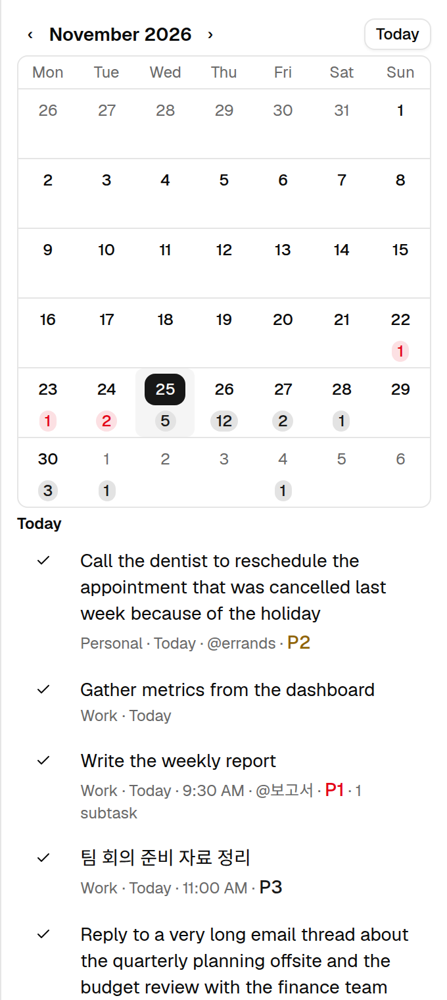
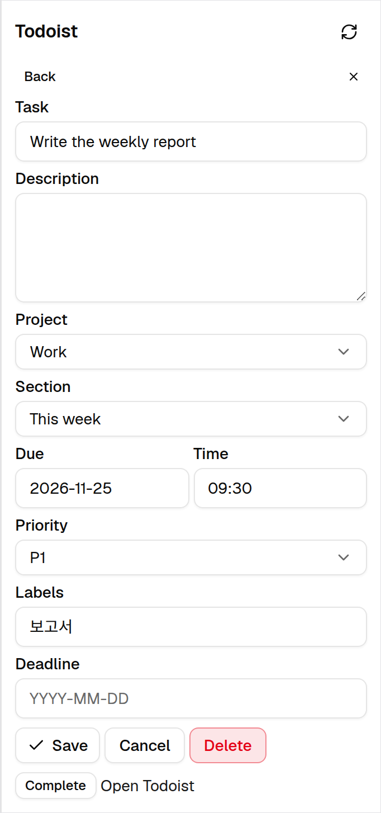
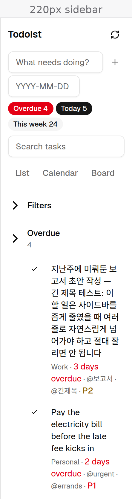
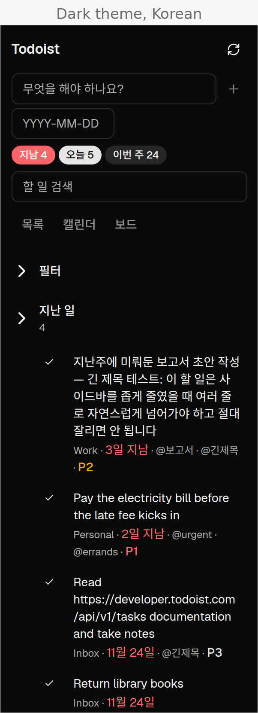

# Todoist for Orca

<p align="center">
  
</p>

Todoist in Orca's right sidebar: list, calendar and board views, filters, a quick add, and a full
task editor. Add, edit, complete, reopen, move and delete tasks, and create projects without
leaving Orca.

There is one surface, the **Todoist** panel: no editor tab and no `+` menu entry. It keeps its
filters and month between openings, follows Orca's light or dark theme and its English or Korean
UI, and stays readable down to the sidebar's smallest width.

## Views

**List** — overdue, today, tomorrow, next 7 days, later and no date, in collapsible groups. Sort by
due date, priority, project, recently added, name or Todoist's manual order. Titles and their
details wrap, so a narrow sidebar never cuts them off.

**Calendar** — a month grid in seven equal columns. A day with tasks shows their number, red when
the day is past, so nothing hides behind a click; choosing a day lists its tasks under the grid.
Moving to another month chooses a day in it. The week starts on Monday or Sunday (Settings →
Todoist).

<p align="center">
  
</p>

**Board** — one section per project, with the same filters and sort.

## Add, edit, complete

The field above the views adds a task, with an optional due date, to the project selected in the
filters or to the Inbox.

<p align="center">
  
</p>

A task opens in the editor with its title, description, project, section, due date and time,
priority, labels and deadline; changing the project or section moves the task. The circle beside a
task completes it, and a completed task offers **Undo**. Delete asks once more, then removes the
task and its subtasks. New projects are created from the filters card.

## Filters

Project, label, priority and date, a **hide subtasks** switch, and a search box that understands
`@label`, `#project` and `p1`…`p4` as well as plain words. The chosen view and filters are
remembered while the plugin stays enabled.

## Small and dark

<p align="center">
  
  &nbsp;&nbsp;&nbsp;
  
</p>

At the sidebar's minimum width the quick add moves its due date under the title, and the editor
stacks due date and time, so no field is squeezed. Everything else wraps in place.

## Install

Needs Orca 1.4.248 or newer. From Orca's **Settings → Plugins → Add plugin**, choose **From a Git
URL** and use:

```
https://github.com/pinion05/orca-todoist
```

or from a terminal:

```sh
orca plugin install pinion05/orca-todoist
```

Orca shows what the plugin can access before it runs. Approve it once. To update an install:

```sh
orca plugin update pinion05.todoist-viewer
```

While the plugin is in the community directory, installs and updates are managed there; a new
release is listed for 12 hours before it installs on its own, and a release that asks for new
access waits for your approval.

## Connect Todoist

1. Open [Todoist → Settings → Integrations](https://app.todoist.com/app/settings/integrations)
   and copy your **API token**.
2. Open the Todoist panel in Orca's right sidebar and paste the token.

The token is checked before it is saved. On a machine with an OS key store it goes to Orca's
encrypted secrets; otherwise it is written to the plugin's `apiToken` setting, and the plugin
says so before you connect. `TODOIST_API_TOKEN` in Orca's environment is used when neither is
set.

## How it works

- `trusted-worker` execution: the worker is the only part that reaches the network. The panel
  has no network; it asks the worker for reads and writes.
- Manifest capabilities: `settings:own`, `secrets:own`, `storage:own`. No workspace, terminal,
  notification, agent or automation capability.
- Requests go only to `https://api.todoist.com`.
- Reads use the `tasks`, `projects`, `sections`, `labels` and `user` endpoints. Writes happen
  only when you act: create, update, complete, reopen, delete or move a task, or create a
  project. Nothing changes in the background.
- Clearing a due date uses Todoist's Sync API (`item_update` with `due: null`), because the REST
  update cannot express an empty due date.
- The last good snapshot is cached in the plugin's storage, so reopening the panel draws at once
  and a failed read still shows the previous tasks with a warning.
- The cache is read again when it is older than **Refresh every** (5 minutes by default, 1–60 in
  Settings), on the refresh button, and when the panel reopens.
- Orca refuses a panel tree of more than 5000 nodes and would then draw nothing. A view with more
  tasks than that draws as many as fit and says how many it left out; narrow the filters to reach
  the rest.
- No telemetry, no analytics, no third-party services.

## Orca notes

Orca plugins contribute panels to the **right** sidebar. There is no left-sidebar contribution
point in the plugin API yet (`sidebarCards` is reserved), so the panel lives on the right and is
the whole Todoist surface. Persist the sidebar with Orca's usual sidebar controls; the plugin
keeps its filters and month between openings.

## Develop

```sh
orca plugin dev watch .
orca plugin test .
orca plugin check .
orca plugin validate .
```

Orca transpiles the TypeScript when it loads, so there is no build step. `.orca/` holds the
generated typings and is ignored by Git. `docs/` holds the screenshots above: 2x captures of the
panel at 220–340px sidebar widths.

```
src/
  worker.ts      Todoist reads and writes, token handling, cache, request handlers
  todoist.ts     API v1 client, normalizer and mutation calls
  select.ts      filters, sorting, date buckets, calendar grid, stats
  panel.tsx      the whole sidebar surface (Orca components)
  messages.ts    English and Korean strings
  protocol.ts    the worker <-> panel contract
```

## License

MIT. See [LICENSE](LICENSE). Not affiliated with or endorsed by Todoist.
