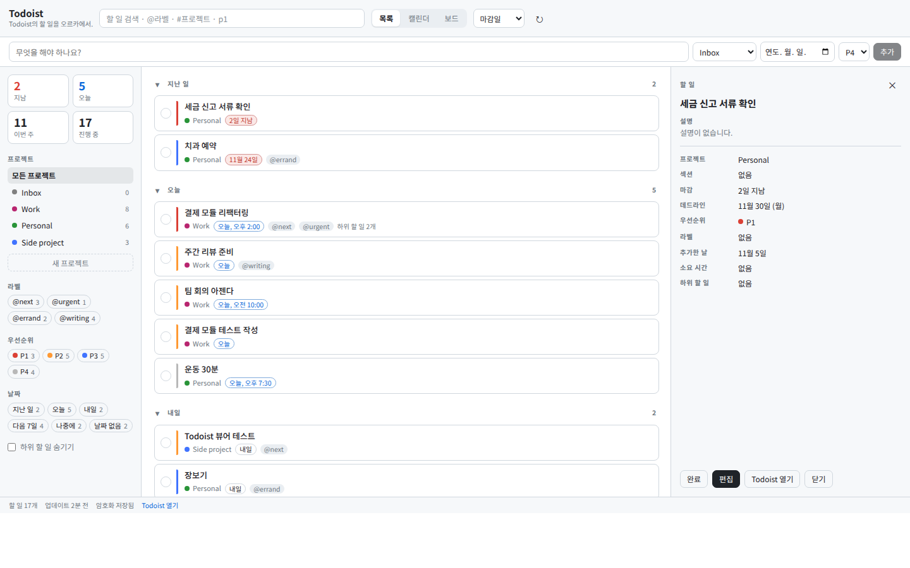
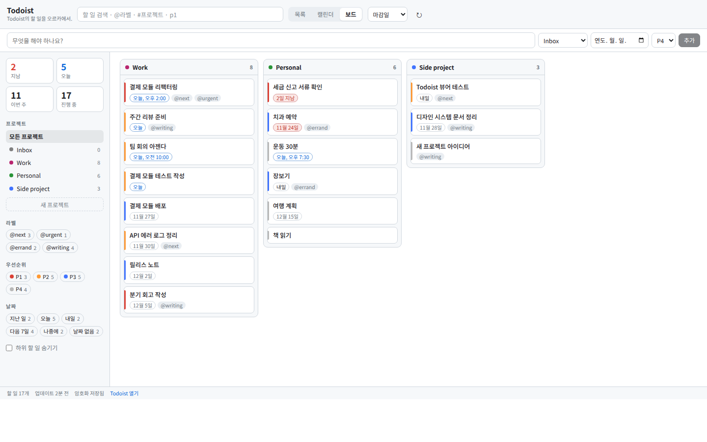

# Todoist for Orca

Todoist inside [Orca](https://www.onorca.dev): a compact panel for the right sidebar, and a full
page with list, calendar and board views. Add, edit, complete, reopen, move and delete tasks,
and create projects without leaving Orca.

## What it looks like

<p align="center">
  
</p>

<p align="center">
  
  
</p>

<p align="center">
  
</p>

The screenshots use a Korean Orca; the plugin follows Orca's UI language and theme.

## What it does

**Right-sidebar panel**

- Overdue, today and next-seven-days counts at a glance.
- Tabs for All, Today, Overdue and This week, each with its count.
- Add a task from the field at the top (Enter adds it), and complete one with the circle beside
  it. A completed task offers Undo in place.
- Today's tasks with project, due time, priority, labels and subtask count, and a link into
  Todoist. The panel refreshes itself while it is open.

**Full page** — open it with the tab bar's **+** menu → **New Todoist view**, or from the
command palette (the entry comes from Orca's new-file menu, not a plugin command). The page is
an editor for `.todoist` files, so a saved view keeps its filters and layout.

- **List** — grouped into Overdue / Today / Tomorrow / Next 7 days / Later / No date, with
  collapsible groups. Or sort by priority, project, recently added, name or Todoist's manual
  order.
- **Calendar** — a six-week month grid with up to three task chips per day, a per-day count,
  month navigation, a Today button and a day list. The week can start on Monday or Sunday.
- **Board** — one column per project, horizontally scrollable, with the same filters and sort.
- **Filters** — projects, labels, priorities, date buckets, "hide subtasks", and a search box
  that understands `@label`, `#project` and `p1`…`p4` as well as plain words.
- **Quick add** — the row above every view adds a task with its project, due date and priority.
  The calendar fills the date from the day you clicked.
- **Edit a task** — title, description, project, section, due date and time, priority, labels
  and deadline; Save moves it when the project changed. Delete asks once, then deletes the task
  and its subtasks; Complete offers Undo.
- **Task detail** — description, project, section, due date and time, deadline, priority,
  labels, added date, duration, subtask count and parent task, with a link into Todoist.
- English and Korean follow Orca's UI language; the page follows Orca's light or dark theme.

## Install

From Orca's **Settings → Plugins → Add plugin**, choose **From a Git URL** and use:

```
https://github.com/pinion05/orca-todoist
```

or from a terminal:

```sh
orca plugin install pinion05/orca-todoist
```

Orca shows what the plugin can access before it runs. Approve it once.

While the plugin is in the community directory, installs and updates are managed there; a new
release is listed for 12 hours before it installs on its own, and a release that asks for new
access waits for your approval.

## Connect Todoist

1. Open [Todoist → Settings → Integrations](https://app.todoist.com/app/settings/integrations)
   and copy your **API token**.
2. Open the plugin (the sidebar panel or a Todoist view) and paste the token.

The token is checked before it is saved. On a machine with an OS key store it goes to Orca's
encrypted secrets; otherwise it is written to the plugin's `apiToken` setting, and the plugin
says so before you connect. `TODOIST_API_TOKEN` in Orca's environment is used when neither is
set.

The plugin reads your account with the `GET` endpoints (`tasks`, `projects`, `sections`,
`labels`, `user`) and writes only when you act: creating, updating, completing, reopening,
deleting or moving a task, or creating a project. It never changes Todoist in the background or
on a schedule. Revoke the token in Todoist at any time.

## How it works

- `trusted-worker` execution: the worker is the only part that reaches the network.
- Manifest capabilities: `settings:own`, `secrets:own`, `storage:own`. No workspace, terminal,
  notification, agent or automation capability.
- Requests go only to `https://api.todoist.com`.
- The last good snapshot is cached in the plugin's storage, so reopening a page draws at once
  and a failed read still shows the previous tasks with a warning.
- The cache is read again when it is older than **Refresh every** (5 minutes by default, 1–60
  in Settings), on the refresh button, and when a page or panel reopens.
- No telemetry, no analytics, no third-party services.

## Orca notes

- Orca plugins contribute panels to the **right** sidebar. There is no left-sidebar
  contribution point in the plugin API yet (`sidebarCards` is reserved), so the compact panel
  lives on the right and the full page is an editor tab.
- The full page is an editor, not a web view: Orca keeps its unsaved view state, saves it with
  the tab's normal save, and a `.todoist` file can be committed or shared like any other file.
  The view settings are in that file; your tasks stay in Todoist.

## Develop

```sh
orca plugin dev watch .
orca plugin test .
orca plugin check .
orca plugin validate .
```

Orca transpiles the TypeScript when it loads, so there is no build step. `.orca/` holds the
generated typings and is ignored by Git.

```
src/
  worker.ts      Todoist reads and writes, token handling, cache, request handlers
  todoist.ts     API v1 client, normalizer and mutation calls
  select.ts      filters, sorting, date buckets, calendar grid, stats
  page-state.ts  the .todoist document shape
  panel.tsx      the right-sidebar panel (Orca components)
  page.html/ts/css  the full page (custom editor)
  messages.ts    English and Korean strings
  protocol.ts    the worker <-> surface contract
```

## License

MIT. See [LICENSE](LICENSE). Not affiliated with or endorsed by Todoist.
